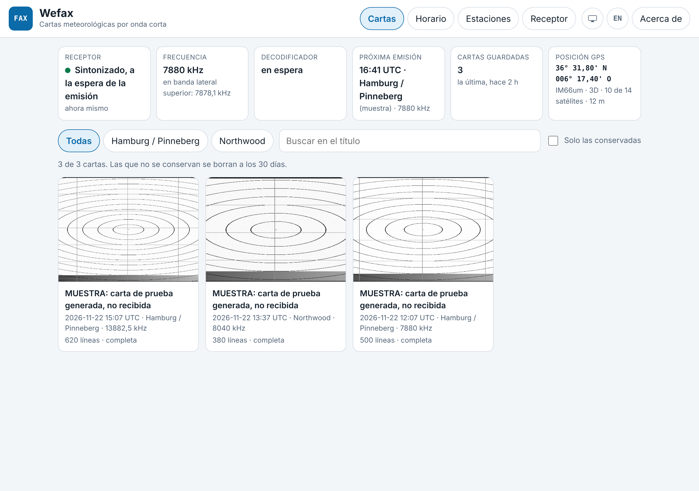
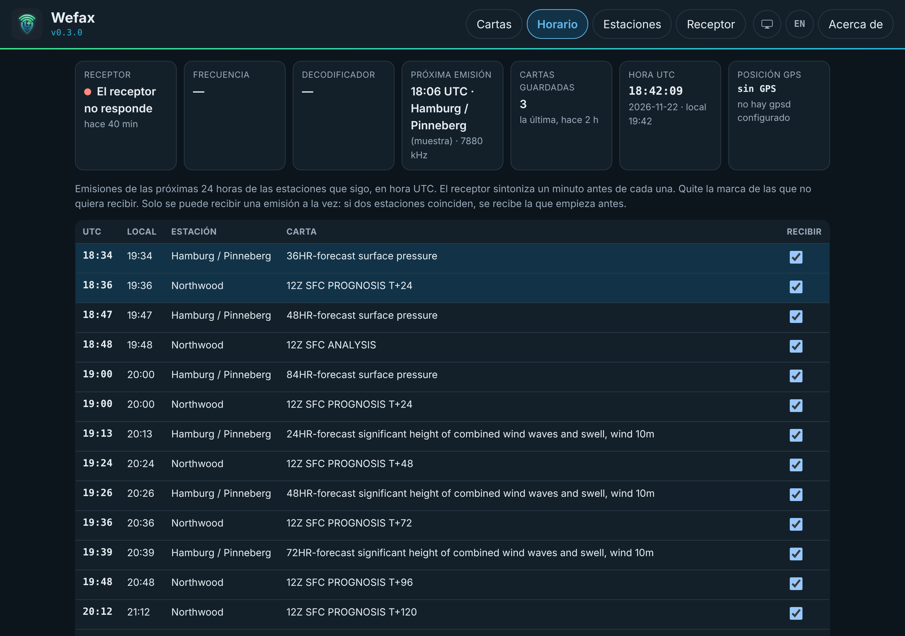
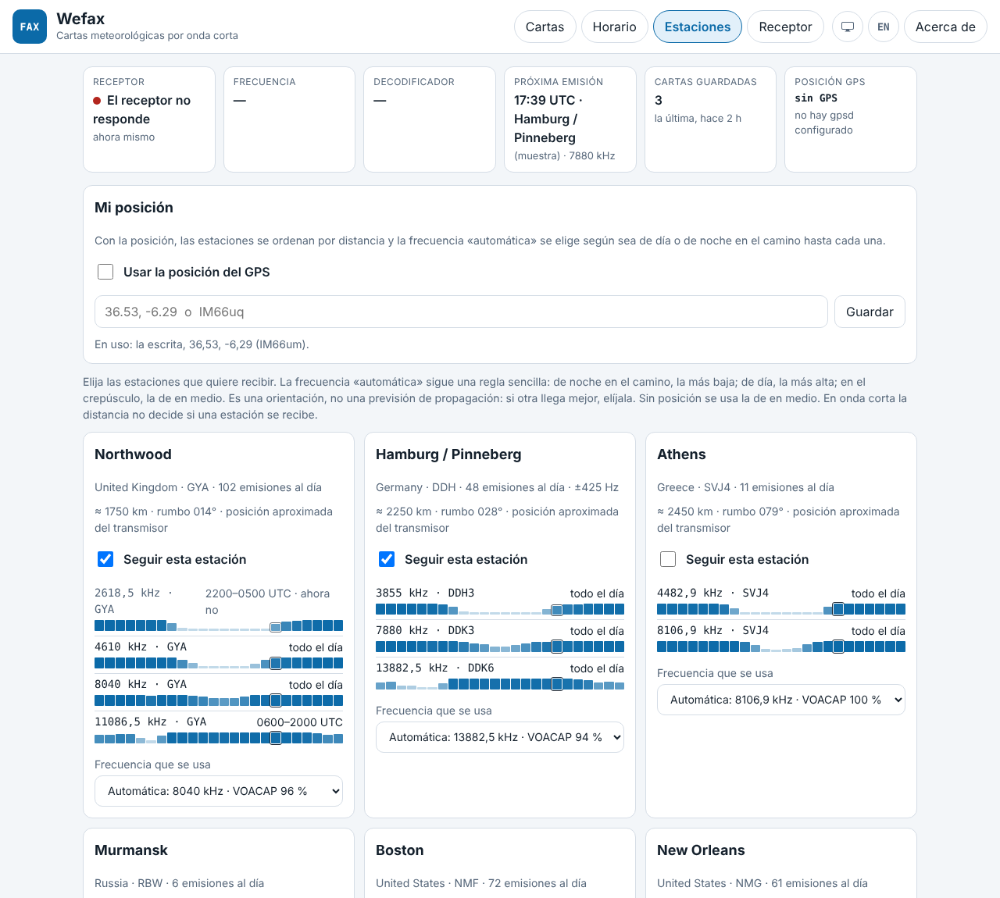

# Wefax

Receptor de radiofacsímil meteorológico (WEFAX, cartas del tiempo por onda corta) por software para Linux, con SDRplay o RTL-SDR. Sigue el horario de las estaciones, sintoniza solo cada emisión y guarda cada carta como imagen.

Wefax · © 2026 Manuel - EA7JRS · GPL-3.0-or-later · parte del ecosistema APRS LoRa+ · hermano de [Navtex](https://github.com/EA7JRS/Navtex)

[](https://paypal.me/ea7jrs)

> **Aviso.** Este programa es una ayuda. No sustituye a los equipos ni a las publicaciones oficiales, y las cartas recibidas pueden llegar incompletas o deformadas.

> **Estado: versión 0.1.0, en construcción.** Están hechos el descodificador, el programa receptor, la interfaz web, los servicios y una lista de cinco estaciones con sus horarios. **Falta** lo más importante: la prueba con una señal real del aire. El detalle está en [Estado](#estado).

📘 [Normas que contempla](docs/NORMAS.md) · 📝 [Historial de cambios](CHANGELOG.md)

## Vista previa


*Carta de prueba, no recibida del aire: la genera el propio proyecto (`test/make_recording.c`) como la entregaría un receptor, con ruido (10 dB) y el receptor 350 Hz fuera de frecuencia, y la descodifica `wefaxreceiver`. Nunca se ha emitido.*

### Interfaz web



*Las tres cartas son la carta de prueba de arriba, y el estado del receptor está puesto a mano para la captura: nada de eso se recibió del aire.*





## Qué hace

| Función | Detalle |
| :--- | :--- |
| Descodifica el radiofacsímil | Índice de cooperación 576 y 288; 60, 90, 120 y 240 líneas por minuto; negro y blanco a ±400 Hz del centro (±425 Hz en las estaciones que lo usan) |
| Encuentra sola cada carta | Tono de inicio (300 o 675 Hz), enfasado y tono de parada (450 Hz); sin tono de parada, la carta acaba al perderse la señal o al cumplirse su hora |
| Corrige el error del receptor | Mide en el tono de inicio cuánto se desvía de frecuencia el receptor (un RTL-SDR puede irse 700 Hz en 14 MHz) y, en el enfasado, el error de su reloj, para que la carta no salga inclinada |
| Dos tipos de receptor | SDRplay (RSP1A, RSP1B, RSP2, RSPdx, RSPdx-R2) y RTL-SDR (muestreo directo, conversor integrado o externo) |
| Sigue el horario | En modo servicio sintoniza cada emisión de las estaciones elegidas un minuto antes. También puede quedarse en una frecuencia fija |
| Comparte el receptor con Navtex | Puede usar un equipo propio o turnarse con [Navtex](https://github.com/EA7JRS/Navtex): le pide que suelte el receptor antes de cada emisión y se lo devuelve al acabar |
| Guarda las cartas | Imágenes PNG con su fecha, estación, frecuencia y título; lista en una base de datos SQLite |
| Interfaz web | Cartas recibidas con visor, carta en curso, horario de las próximas 24 horas con casilla por emisión, estaciones y ajustes del receptor. Claro, oscuro y noche; español e inglés. Sin contraseña: solo en una red de confianza |
| Descodifica grabaciones | Para probar y para repasar una recepción dudosa |

## Estado

Hecho y comprobado en el PC (`make check`, 89 comprobaciones):

- el descodificador, con señales generadas por las propias pruebas: las cuatro velocidades, los dos índices, ruido, error de reloj de ±60 ppm, receptor 700 Hz fuera de frecuencia, tono de inicio corto, señal que se pierde;
- la cadena entera, de las muestras del receptor a la imagen PNG;
- la base de datos, el horario (con una lista de estaciones inventada para la prueba) y los ajustes;
- el programa `wefaxreceiver` descodificando una grabación generada;
- la interfaz web en un navegador, con una base de datos de muestra (las capturas de arriba).

**Sin probar:**

- una señal real del aire, con ningún receptor. El programa compila con RTL-SDR; **la parte de SDRplay no se ha podido compilar** donde se escribió (no hay API), solo en un equipo que la tenga;
- el turno con Navtex contra un Navtex en marcha;
- los servicios y su instalador, en ningún equipo (el guion solo se ha revisado con `sh -n`);
- **la lista de estaciones contra el original**: se transcribió del PDF de la NOAA con un lector automático y no se ha cotejado línea a línea. Compruebe una hora antes de fiarse de ella.

**Sin hacer todavía:**

- más estaciones: la lista trae Hamburgo / Pinneberg, Northwood, Boston, Nueva Orleans y Point Reyes. Kodiak y Honolulu quedaron fuera porque su tabla, de dos horas por fila, no se pudo leer con seguridad; Atenas no publica horario; faltan las de Asia, Chile, Canadá y Australia;
- el enfasado simétrico (mitad blanco, mitad negro), que algunas estaciones pueden usar: esas cartas saldrían desplazadas.

## Qué hace falta

- Un equipo con Linux (hecho en Debian 13).
- Un receptor que llegue a onda corta (2 a 23 MHz): **SDRplay** con su API 3.15 o posterior, o **RTL-SDR** con muestreo directo (Nooelec NESDR SMArt v5, RTL-SDR Blog V3), conversor integrado (RTL-SDR Blog V4) o conversor externo.
- Una antena de onda corta.

### Dependencias y librerías

| Paquete de Debian | Para qué | ¿Obligatorio? |
| :--- | :--- | :--- |
| `git`, `build-essential`, `autoconf`, `automake` | Descargar y compilar | Sí |
| `zlib1g-dev` | zlib: comprime las imágenes PNG | Sí |
| `libcjson-dev` | cJSON: la lista de estaciones y la API | Sí |
| `libsqlite3-dev` | SQLite: ajustes y lista de cartas | Sí |
| `libmicrohttpd-dev` | GNU libmicrohttpd: el servidor de la interfaz web | Sí |
| `librtlsdr-dev` | Receptores RTL-SDR | Solo con RTL-SDR |
| API de SDRplay 3.15 o posterior | Receptores SDRplay; se baja de [sdrplay.com/api](https://www.sdrplay.com/api/) | Solo con SDRplay |

## Instalación

```bash
sudo apt install git build-essential autoconf automake zlib1g-dev libcjson-dev libsqlite3-dev libmicrohttpd-dev librtlsdr-dev
```

```bash
git clone https://github.com/EA7JRS/Wefax.git
cd Wefax
autoreconf -i && automake --add-missing; autoreconf
./configure && make
make check
sudo make install
```

`./configure` acaba diciendo qué receptores quedan incluidos (`receivers: SDRplay yes, RTL-SDR yes`). Los programas van a `/usr/local/bin`; la interfaz, las cartas y la base de datos, a `/opt/Wefax`.

Para que arranquen solos como servicios (con su usuario, no con root):

```bash
sudo sh tools/instalar-servicios.sh
```

Después abra `http://<equipo>:8081/`, elija las estaciones en **Estaciones** y encienda el receptor en **Receptor**. Hasta entonces el receptor no toca ningún equipo. El puerto se cambia en `/etc/default/wefax` (Navtex usa el 8080).

> La interfaz web no tiene contraseña: déjela solo en una red de confianza, o en `127.0.0.1`.

### Actualizar

```bash
cd Wefax
git pull
```

```bash
autoreconf -i && automake --add-missing; autoreconf
./configure && make
sudo make install
```

```bash
sudo systemctl restart wefax-web wefax-receiver
```

`sudo make install` sustituye la interfaz y la lista de estaciones de `/opt/Wefax/build`; no toca las cartas ni los ajustes.

### Desinstalar

```bash
sudo sh tools/instalar-servicios.sh --quitar
sudo make uninstall
```

Las cartas y los ajustes quedan en `/opt/Wefax`; bórrelos a mano si ya no los quiere.

## Comandos

### `wefaxreceiver`

| Opción | Qué hace |
| :--- | :--- |
| `-h` | Ayuda |
| `-n` | Servicio: sigue el horario y los ajustes de la base de datos |
| `-k <kHz>` | Se queda en esa frecuencia (la asignada: el centro del canal) |
| `-s sdrplay` \| `rtlsdr` \| `file` | Tipo de equipo |
| `-l <lpm>` | Líneas por minuto esperadas: 60, 90, 120 (de serie) o 240 |
| `-m` | Manual: toma líneas ya, sin esperar un tono de inicio (emisión cogida a medias); `-I 288` para ese índice |
| `-o <carpeta>` | Escribe las cartas ahí y no toca la base de datos |
| `-b` | Alimenta la antena por el coaxial |
| `-p A` \| `B` \| `C` | SDRplay: toma de antena |
| `-S <serie>` | Elige el equipo por su número de serie |
| `-i`, `-D`, `-u`, `-g`, `-P` | RTL-SDR: número de equipo, muestreo directo, conversor externo, ganancia y corrección en ppm |
| `-f <archivo>` | Descodifica una grabación: I/Q a 252000 muestras/s (`.wav` de 16 bits o 8 bits sin signo) |
| `-O <Hz>` | Dónde está el canal en la grabación respecto a su centro (de serie, 20000) |
| `-t` | Reproduce la grabación a velocidad real |
| `-q` | Solo lo importante |

```bash
wefaxreceiver -s rtlsdr -k 7880        # escuchar 7880 kHz con un RTL-SDR; las cartas, en la carpeta actual
wefaxreceiver -k 13882.5 -o cartas     # con un SDRplay
wefaxreceiver -f grabacion.wav         # descodificar una grabación
```

**La frecuencia** es la asignada, que es el centro del canal: negro 400 Hz por debajo y blanco 400 Hz por encima. Con un receptor de banda lateral superior se sintonizaría 1,9 kHz por debajo; aquí no hace falta restar nada.

### `wefaxwebserver`

```bash
wefaxwebserver [puerto] [dirección]     # de serie: 8081, todas las direcciones
```

| Ruta | Qué da |
| :--- | :--- |
| `GET /api/status` | Qué hace el receptor |
| `GET /api/charts?since=&limit=` | Las cartas recibidas, la más nueva primero |
| `GET /api/next` | La emisión en curso o la siguiente |
| `GET /api/settings` | Los ajustes |
| `GET /api/about` | La versión |
| `GET /chart/<id>.png`, `GET /live.png` | Una carta; la que se está recibiendo |
| `POST /api/settings/<nombre>/<valor>` | Cambia un ajuste (con la cabecera `X-Wefax`) |
| `POST /api/charts/keep/<id>/<0\|1>` | Marca una carta para conservarla |

### Servicios

```bash
systemctl status wefax-web wefax-receiver
journalctl -u wefax-receiver -f
sudo systemctl restart wefax-receiver
```

### Lista de estaciones

`web_server/build/estaciones.json` se hace con `python3 tools/estaciones/generar.py` a partir de los archivos de texto de `tools/estaciones`, uno por estación, transcritos de [«Worldwide Marine Radiofacsimile Broadcast Schedules»](https://www.weather.gov/media/marine/rfax.pdf) de la NOAA (edición del 7 de marzo de 2025). Para corregir una hora o añadir una estación, edite su archivo y vuelva a generar.

### Probar sin radio

```bash
gcc -O2 -o make_recording test/make_recording.c -lm
./make_recording prueba.wav 400 10 350    # 400 líneas, 10 dB de señal, receptor 350 Hz fuera
wefaxreceiver -f prueba.wav
```

## Cómo es una emisión

| Parte | Duración | Qué es |
| :--- | :--- | :--- |
| Tono de inicio | 5 a 10 s | Negro y blanco alternando 300 veces por segundo (índice 576) o 675 (índice 288) |
| Enfasado | 30 s | Líneas negras con un pulso blanco del 5 %: el centro del pulso marca dónde empieza cada línea |
| La carta | 8 a 20 min | Líneas a 120 por minuto (también 60, 90 y 240), de 1810 puntos con el índice 576 |
| Tono de parada | 5 s | Alternancia a 450 Hz, y después 10 s de negro |

Son las características del Manual del Sistema Mundial de Telecomunicación de la OMM (n.º 386, parte III, apartado 5). Más en [docs/NORMAS.md](docs/NORMAS.md).

## Créditos y licencia

GPL-3.0-or-later, con permiso adicional para enlazar con la API de SDRplay. El detalle, y lo que procede de otros, en [COPYING.md](COPYING.md).

## Apoya el proyecto

[paypal.me/ea7jrs](https://paypal.me/ea7jrs)
