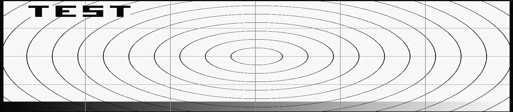

# Wefax

Receptor de radiofacsímil meteorológico (WEFAX, cartas del tiempo por onda corta) por software para Linux, con SDRplay o RTL-SDR. Sigue el horario de las estaciones, sintoniza solo cada emisión y guarda cada carta como imagen.

Wefax · © 2026 Manuel - EA7JRS · GPL-3.0-or-later · parte del ecosistema APRS LoRa+ · hermano de [Navtex](https://github.com/EA7JRS/Navtex)

[](https://paypal.me/ea7jrs)

> **Aviso.** Este programa es una ayuda. No sustituye a los equipos ni a las publicaciones oficiales, y las cartas recibidas pueden llegar incompletas o deformadas.

> **Estado: versión 0.2.0, en construcción.** Están hechos el descodificador, el programa receptor, la interfaz web, los servicios y una lista de nueve estaciones con sus horarios. **Falta** lo más importante: la prueba con una señal real del aire. El detalle está en [Estado](#estado).

📘 [Normas que contempla](docs/NORMAS.md) · 📝 [Historial de cambios](CHANGELOG.md) · 🏷️ [Notas de la 0.2.0](docs/releases/v0.2.0.md)

## Vista previa



*Carta de prueba, no recibida del aire: la genera el propio proyecto (`test/make_recording.c`) como la entregaría un receptor, con ruido (10 dB) y el receptor 350 Hz fuera de frecuencia, y la descodifica `wefaxreceiver`. Nunca se ha emitido.*

### Interfaz web


*Las tres cartas son la carta de prueba de arriba, y el estado del receptor y la posición del GPS están puestos a mano para la captura: nada de eso se recibió del aire.*


## Qué hace

| Función | Detalle |
| :--- | :--- |
| Descodifica el radiofacsímil | Índice de cooperación 576 y 288; 60, 90, 120 y 240 líneas por minuto; negro y blanco a ±400 Hz del centro (±425 Hz en las estaciones que lo usan) |
| Encuentra sola cada carta | Tono de inicio (300 o 675 Hz), enfasado y tono de parada (450 Hz); sin tono de parada, la carta acaba al perderse la señal o al cumplirse su hora |
| Corrige el error del receptor | Mide en el tono de inicio cuánto se desvía de frecuencia el receptor (un RTL-SDR puede irse 700 Hz en 14 MHz) y, en el enfasado, el error de su reloj, para que la carta no salga inclinada |
| Dos tipos de receptor | SDRplay (RSP1A, RSP1B, RSP2, RSPdx, RSPdx-R2) y RTL-SDR (muestreo directo, conversor integrado o externo) |
| Sigue el horario | En modo servicio sintoniza cada emisión de las estaciones elegidas un minuto antes. También puede quedarse en una frecuencia fija |
| Comparte el receptor con Navtex | Puede usar un equipo propio o turnarse con [Navtex](https://github.com/EA7JRS/Navtex): le pide que suelte el receptor antes de cada emisión y se lo devuelve al acabar |
| Guarda las cartas | Imágenes PNG con su fecha, estación, frecuencia y título; lista en una base de datos SQLite |
| Interfaz web | Cartas recibidas con visor, carta en curso, horario de las próximas 24 horas con casilla por emisión, estaciones y ajustes del receptor. Claro, oscuro y noche; español e inglés. Sin contraseña: solo en una red de confianza |
| Solo onda corta | No recibe imágenes de satélite: el WEFAX de los geoestacionarios ya no se emite y lo que hay hoy (LRPT, HRIT) es digital, otro sistema |
| Posición propia | La del GPS (gpsd, como Navtex) o la que se escriba. Con ella las estaciones salen por distancia, con su rumbo, y la frecuencia «automática» se elige según sea de día o de noche en el camino |
| Ayuda para leer la carta | Isobaras, viento, frentes, tipos de carta y escala Beaufort, en la pestaña Cartas |
| Descodifica grabaciones | Para probar y para repasar una recepción dudosa |

## Estado

Hecho y comprobado en el PC (`make check`, 103 comprobaciones):

- el descodificador, con señales generadas por las propias pruebas: las cuatro velocidades, los dos índices, ruido, error de reloj de ±60 ppm, receptor 700 Hz fuera de frecuencia, tono de inicio corto, señal que se pierde;
- la cadena entera, de las muestras del receptor a la imagen PNG;
- la base de datos, el horario (con una lista de estaciones inventada para la prueba) y los ajustes;
- el programa `wefaxreceiver` descodificando una grabación generada;
- la interfaz web en un navegador, con una base de datos de muestra (las capturas de arriba).

Comprobado en un equipo real (Debian 13, con la API de SDRplay y librtlsdr): compila, pasa `make check`, se instala, los servicios arrancan y la interfaz se abre desde la red local.

**Sin probar:**

- una señal real del aire, con ningún receptor. El programa compila con RTL-SDR; la parte de SDRplay compila, pero **no se ha usado todavía con un receptor**;
- el turno con Navtex contra un Navtex en marcha;
- **la lista de estaciones contra el original**: se transcribió con un lector automático y no se ha cotejado línea a línea. Las de EE. UU. salen del horario en texto de cada estación (limpio, una fila por carta); Hamburgo y Northwood, del PDF mundial, más propenso a errores. Compruebe una hora antes de fiarse de ella.

**Sin hacer todavía:**

- más estaciones: la lista trae Hamburgo / Pinneberg, Northwood, Atenas, Múrmansk, Boston, Nueva Orleans, Point Reyes, Kodiak y Honolulu. Faltan las de Asia, Chile y Australia;
- **Atenas y Múrmansk son dudosas**: de Atenas no está claro si las frecuencias publicadas (4481 y 8105 kHz) son el centro del canal o la portadora (la lista usa 4482,9 y 8106,9, como dice la NOAA); de Múrmansk la propia NOAA duda de que siga emitiendo, y las frecuencias salen de otra lista;
- el enfasado simétrico (mitad blanco, mitad negro), que algunas estaciones pueden usar: esas cartas saldrían desplazadas.

## Qué hace falta

- Un equipo con Linux (hecho en Debian 13).
- Un receptor que llegue a onda corta (2 a 23 MHz): **SDRplay** con su API 3.15 o posterior, o **RTL-SDR** con muestreo directo (Nooelec NESDR SMArt v5, RTL-SDR Blog V3), conversor integrado (RTL-SDR Blog V4) o conversor externo.
- Una antena de onda corta.

### Dependencias y librerías

| Paquete de Debian | Para qué | ¿Obligatorio? |
| :--- | :--- | :--- |
| `git`, `build-essential`, `autoconf`, `automake` | Descargar y compilar | Sí |
| `zlib1g-dev` | zlib: comprime las imágenes PNG | Sí |
| `libcjson-dev` | cJSON: la lista de estaciones y la API | Sí |
| `libsqlite3-dev` | SQLite: ajustes y lista de cartas | Sí |
| `libmicrohttpd-dev` | GNU libmicrohttpd: el servidor de la interfaz web | Sí |
| `librtlsdr-dev` | Receptores RTL-SDR | Solo con RTL-SDR |
| API de SDRplay 3.15 o posterior | Receptores SDRplay; se baja de [sdrplay.com/api](https://www.sdrplay.com/api/) | Solo con SDRplay |

## Instalación

**1. Dependencias.** Si va a usar un SDRplay, instale antes su API.

```bash
sudo apt install git build-essential autoconf automake zlib1g-dev libcjson-dev libsqlite3-dev libmicrohttpd-dev librtlsdr-dev
```

**2. Descargar el código.** En su carpeta personal, no en `/opt/Wefax`: ahí van la interfaz instalada, las cartas y la base de datos.

```bash
cd ~
git clone https://github.com/EA7JRS/Wefax.git
cd Wefax
```

**3. Compilar.**

```bash
autoreconf -i && automake --add-missing; autoreconf
./configure
make
```

`./configure` acaba con una línea como `receivers: SDRplay yes, RTL-SDR yes`: compruebe que el suyo dice `yes`.

**4. Comprobar (opcional).** Pasa las pruebas del descodificador, la cadena hasta la imagen, la base de datos y el horario; no toca la instalación.

```bash
make check
```

**5. Instalar los programas.** Van a `/usr/local/bin`; la interfaz web, las cartas y la base de datos, a `/opt/Wefax`.

```bash
sudo make install
```

**6. Montar los servicios.** Toma como usuario el que ejecuta `sudo`. Si trabaja como `root` directamente, indíquelo con `--usuario <nombre>` (no puede ser `root`).

```bash
sudo sh tools/instalar-servicios.sh
```

**7. Abrir el cortafuegos**, si lo hay, a la red local. Ponga el rango de su red (`10.0.0.0/8`, `172.16.0.0/12` o `192.168.0.0/16`):

```bash
sudo ufw allow from 192.168.0.0/16 to any port 8081 proto tcp
```

**8. Abrir la interfaz:** `http://<equipo>:8081/`. Elija las estaciones en la pestaña **Estaciones**, y el equipo en **Receptor**; después marque **Encendido**. Hasta entonces el receptor no toca ningún equipo.

### Actualizar

Desde la carpeta donde se clonó el código:

```bash
git pull
autoreconf -i && automake --add-missing; autoreconf
./configure && make
sudo make install
sudo systemctl restart wefax-web wefax-receiver
```

Las cartas y los ajustes se conservan; `sudo make install` solo sustituye los programas, la interfaz y la lista de estaciones. Después, recargue la página con Ctrl+F5. Si las notas de la versión dicen que cambian los servicios, repita además el paso 6.

### Desinstalar

```bash
sudo sh tools/instalar-servicios.sh --quitar     # para y retira los servicios
sudo make uninstall                              # quita los programas de /usr/local/bin
```

`/opt/Wefax` (cartas y ajustes) y `/etc/default/wefax` no se borran: quítelos a mano si ya no los quiere.

## Servicios

| Servicio | Qué hace |
| :--- | :--- |
| `wefax-web` | La interfaz web y la API, en el puerto 8081 |
| `wefax-receiver` | El receptor: siempre en marcha, pero no toca ningún equipo hasta que se enciende en la web |

Ninguno se ejecuta como `root`. El puerto, la dirección de escucha y el gpsd de la interfaz web están en `/etc/default/wefax`. Navtex usa el puerto 8080 y Wefax el 8081: pueden convivir en el mismo equipo.

**Receptor compartido.** Un equipo solo lo puede usar un programa a la vez. Si el receptor dice «Sin equipo», lo tiene otro programa (Navtex, SDRconnect, SDR++) o está desconectado; lo reintenta cada 15 segundos. Con [Navtex](https://github.com/EA7JRS/Navtex) puede turnarse solo: pestaña Receptor, «Compartir el equipo con Navtex».

Registro en vivo: `journalctl -u wefax-receiver -f`

## Comandos

### Servicios

| Comando | Qué hace |
| :--- | :--- |
| `systemctl is-active wefax-web wefax-receiver` | Dice si los dos están en marcha |
| `systemctl status wefax-web` | Estado y últimas líneas de la interfaz web |
| `sudo systemctl restart wefax-web` | Reinicia la interfaz web (tras cambiar `/etc/default/wefax` o actualizar) |
| `sudo systemctl restart wefax-receiver` | Reinicia el receptor |
| `sudo systemctl stop wefax-receiver` | Suelta el equipo, por ejemplo para usarlo con otro programa |
| `journalctl -u wefax-receiver -f` | Registro en vivo del receptor: sintonía, tonos y cartas guardadas |
| `journalctl -u wefax-web -n 50` | Últimas 50 líneas de la interfaz web |
| `sudo sh tools/instalar-servicios.sh --usuario <nombre>` | Vuelve a montar los servicios, con ese usuario |
| `sudo sh tools/instalar-servicios.sh --quitar` | Para y retira los servicios |

### `wefaxreceiver`: el receptor

El servicio lo arranca con `-q -n`. A mano sirve para probar un equipo, escuchar una frecuencia o descodificar una grabación (pare antes el servicio si usa el mismo equipo).

| Opción | Qué hace |
| :--- | :--- |
| `-h` | Ayuda |
| `-n` | Servicio: sigue el horario y los ajustes de la base de datos |
| `-k <kHz>` | Se queda en esa frecuencia (la asignada: el centro del canal) |
| `-s sdrplay` \| `rtlsdr` \| `file` | Tipo de equipo |
| `-l <lpm>` | Líneas por minuto esperadas: 60, 90, 120 (de serie) o 240 |
| `-m` | Manual: toma líneas ya, sin esperar un tono de inicio (emisión cogida a medias); `-I 288` para ese índice |
| `-o <carpeta>` | Escribe las cartas ahí y no toca la base de datos |
| `-b` | Alimenta la antena por el coaxial |
| `-p A` \| `B` \| `C` | SDRplay: toma de antena |
| `-S <serie>` | Elige el equipo por su número de serie |
| `-i`, `-D`, `-u`, `-g`, `-P` | RTL-SDR: número de equipo, muestreo directo, conversor externo, ganancia y corrección en ppm |
| `-f <archivo>` | Descodifica una grabación: I/Q a 252000 muestras/s (`.wav` de 16 bits o 8 bits sin signo) |
| `-O <Hz>` | Dónde está el canal en la grabación respecto a su centro (de serie, 20000) |
| `-t` | Reproduce la grabación a velocidad real |
| `-q` | Solo lo importante |

```bash
wefaxreceiver -s rtlsdr -k 7880        # escuchar 7880 kHz con un RTL-SDR; las cartas, en la carpeta actual
wefaxreceiver -k 13882.5 -o cartas     # con un SDRplay
wefaxreceiver -f grabacion.wav         # descodificar una grabación
```

**La frecuencia** es la asignada, que es el centro del canal: negro 400 Hz por debajo y blanco 400 Hz por encima. Con un receptor de banda lateral superior se sintonizaría 1,9 kHz por debajo; aquí no hace falta restar nada.

### `wefaxwebserver`: la interfaz web y la API

```bash
wefaxwebserver [puerto] [dirección]
```

| Argumento | Qué es |
| :--- | :--- |
| `puerto` | Puerto TCP (de serie, 8081) |
| `dirección` | Dirección IPv4 en la que escucha (de serie, todas); `127.0.0.1` para solo este equipo |

Como servicio toma el puerto, la dirección y el gpsd de `/etc/default/wefax` (`WEB_PORT`, `WEB_ADDRESS`, `WEFAX_GPSD`); tras cambiarlos, `sudo systemctl restart wefax-web`.

### Compilación

| Comando | Qué hace |
| :--- | :--- |
| `autoreconf -i && automake --add-missing; autoreconf` | Genera `configure` (tras clonar o actualizar) |
| `./configure` | Comprueba las librerías y prepara la compilación |
| `make` | Compila `wefaxreceiver` y `wefaxwebserver` |
| `make check` | Pasa las pruebas (93 comprobaciones) |
| `sudo make install` | Instala los programas, la interfaz y la lista de estaciones; conserva cartas y ajustes |
| `sudo make uninstall` | Quita los programas |
| `make clean` | Borra lo compilado |

### Consultas rápidas

```bash
curl -s http://127.0.0.1:8081/api/about                   # versión
curl -s http://127.0.0.1:8081/api/status                  # qué hace el receptor
curl -s http://127.0.0.1:8081/api/next                    # emisión en curso o la siguiente
curl -s "http://127.0.0.1:8081/api/charts?limit=10"       # las diez últimas cartas, en JSON
curl -s -o carta.png http://127.0.0.1:8081/chart/1.png    # guardar la carta número 1
curl -s http://127.0.0.1:8081/api/gps                     # posición que da gpsd
ss -tulpn | grep -E "8081|wefax"                          # ¿está escuchando?
```

### Dónde está cada cosa

| Ruta | Qué hay |
| :--- | :--- |
| `/usr/local/bin/wefaxreceiver`, `/usr/local/bin/wefaxwebserver` | Los dos programas |
| `/opt/Wefax/Wefax.db` | Ajustes, estado y lista de cartas (SQLite) |
| `/opt/Wefax/charts/AAAAMMDD/` | Las cartas, en PNG; `charts/live.png` es la que se está recibiendo |
| `/opt/Wefax/build/` | La interfaz web y `estaciones.json` |
| `/etc/default/wefax` | Puerto, dirección de escucha y gpsd de la interfaz web |
| `/etc/systemd/system/wefax-web.service`, `wefax-receiver.service` | Los servicios |

### Lista de estaciones

`web_server/build/estaciones.json` se hace con `python3 tools/estaciones/generar.py` a partir de los archivos de texto de `tools/estaciones`, uno por estación. Las cinco de EE. UU. se transcribieron de los [horarios por estación del National Weather Service](https://www.weather.gov/marine/radiofax_charts) (`hfmarsh.txt`, `hfgulf.txt`, `hfreyes.txt`, `hfak.txt`, `hfhi.txt`; datos del 12 de diciembre de 2024); Hamburgo y Northwood, de [«Worldwide Marine Radiofacsimile Broadcast Schedules»](https://www.weather.gov/media/marine/rfax.pdf) (edición del 7 de marzo de 2025). Cada archivo dice su origen y su fecha. Para ver qué otras estaciones hay en el mundo y cuáles han dejado de emitir, la [lista de radiofacsímil de DX Info Centre](https://www.dxinfocentre.com/rafax.htm) (W. R. Hepburn) está al día; no se copia aquí, pero las frecuencias de las estaciones se han contrastado con ella. Para corregir una hora o añadir una estación, edite su archivo y vuelva a generar.

### Probar sin radio

```bash
gcc -O2 -o make_recording test/make_recording.c -lm
./make_recording prueba.wav 400 10 350    # 400 líneas, 10 dB de señal, receptor 350 Hz fuera
wefaxreceiver -f prueba.wav
```

## API

Sin contraseña. Los cambios piden `POST` y la cabecera `X-Wefax` (así una página de otro sitio no puede hacerlos desde el navegador).

| Ruta | Qué da |
| :--- | :--- |
| `GET /api/about` | La versión |
| `GET /api/status` | Qué hace el receptor: estado, frecuencia, descodificador, próxima emisión |
| `GET /api/next` | La emisión en curso o la siguiente de las estaciones seguidas, con la frecuencia elegida, por qué (`n` noche, `t` crepúsculo, `d` día, `m` la de en medio) y la distancia |
| `GET /api/charts?since=<id>&limit=<n>` | Las cartas recibidas, la más nueva primero |
| `GET /api/settings` | Los ajustes |
| `GET /api/gps` | La posición que da gpsd |
| `GET /chart/<id>.png` | Una carta |
| `GET /live.png` | La carta que se está recibiendo |
| `GET /estaciones.json` | Estaciones, frecuencias y horarios |
| `POST /api/settings/<nombre>/<valor>` | Cambia un ajuste (`-` como valor lo deja vacío) |
| `POST /api/charts/keep/<id>/<0\|1>` | Marca una carta para conservarla, o le quita la marca |

## Posición por GPS

La interfaz web lee la posición de gpsd: de serie, el del propio equipo (`127.0.0.1:2947`), el mismo que usa Navtex. Se cambia o se quita con `WEFAX_GPSD` en `/etc/default/wefax`. El servidor solo lee; no envía nada al GPS. La posición se muestra en el recuadro «Posición GPS» y decide el aspecto «Automático» (claro de día, oscuro de noche). Sin GPS se puede escribir en la pestaña Estaciones (grados decimales o localizador).

**Para qué sirve la posición.** En onda corta la distancia no decide si una estación se recibe, así que Wefax no habla de «alcance». La usa para tres cosas: ordenar las estaciones de cerca a lejos, dar la distancia y el rumbo, y elegir la frecuencia «automática» con una regla sencilla según el sol en el punto medio del camino: de noche (sol más de 6° bajo el horizonte), la más baja desde 3 MHz; en el crepúsculo, la de en medio; de día, la más alta (hasta 14,5 MHz si el camino mide menos de 3000 km). Es una orientación, no una previsión de propagación; cada estación permite fijar otra frecuencia. La posición de cada transmisor es aproximada (a la décima de grado, la de su localidad): no viene en los horarios. Con un Leo Bodnar LBE-1420, véase lo que dice el [README de Navtex](https://github.com/EA7JRS/Navtex#posición-por-gps).

## Seguridad

La interfaz no tiene contraseña: está pensada para la red local o la de a bordo. No la exponga a Internet.

- El servidor web y el receptor no se ejecutan como `root`; el servidor web va además encerrado en su carpeta.
- Solo se sirven los archivos de la interfaz y las cartas; no se puede pedir ninguno de fuera.
- Los ajustes solo admiten nombres y valores conocidos, y las consultas a la base de datos no se construyen con texto recibido.
- Los títulos y datos se escriben siempre como texto en la página.
- Con `WEB_ADDRESS=127.0.0.1` escucha solo en el propio equipo.

## Solución de problemas

| Síntoma | Causa probable | Qué hacer |
| :--- | :--- | :--- |
| La página no carga desde otro equipo, pero `curl` en el propio equipo responde | Cortafuegos | Abra el puerto 8081 al rango de su red (paso 7) |
| El instalador dice «Indique el usuario…» | Se ejecutó como `root` sin `sudo` | `sh tools/instalar-servicios.sh --usuario <nombre>` |
| `git pull` dice «dubious ownership» | El código está en una carpeta de otro usuario | `git config --global --add safe.directory <carpeta>` |
| Receptor «Sin equipo» | Desconectado, o en uso por otro programa | `lsusb`; pare el otro programa o use el turno con Navtex |
| «No sigue ninguna estación» | No hay ninguna marcada | Pestaña Estaciones |
| «Sintonizado» pero no llega ninguna carta | Propagación, frecuencia poco adecuada a esa hora, antena | Pruebe otra frecuencia de la estación; de día las altas, de noche las bajas |
| Carta inclinada | Error de reloj del receptor que el enfasado no midió bien | Guarde la carta y avise: es un fallo a corregir |
| Carta partida, con el borde en medio | Sin sincronía (emisión cogida a medias) o enfasado simétrico | Dice «sin sincronía» en sus datos; el enfasado simétrico no está hecho |
| «gpsd no contesta» | gpsd parado, o en otro equipo | `systemctl status gpsd`; `WEFAX_GPSD` en `/etc/default/wefax` |

## Cómo es una emisión

| Parte | Duración | Qué es |
| :--- | :--- | :--- |
| Tono de inicio | 5 a 10 s | Negro y blanco alternando 300 veces por segundo (índice 576) o 675 (índice 288) |
| Enfasado | 30 s | Líneas negras con un pulso blanco del 5 %: el centro del pulso marca dónde empieza cada línea |
| La carta | 8 a 20 min | Líneas a 120 por minuto (también 60, 90 y 240), de 1810 puntos con el índice 576 |
| Tono de parada | 5 s | Alternancia a 450 Hz, y después 10 s de negro |

Son las características del Manual del Sistema Mundial de Telecomunicación de la OMM (n.º 386, parte III, apartado 5). Más en [docs/NORMAS.md](docs/NORMAS.md).

## Créditos y licencia

GPL-3.0-or-later, con permiso adicional para enlazar con la API de SDRplay. El detalle, y lo que procede de otros, en [COPYING.md](COPYING.md).

## Apoya el proyecto

[paypal.me/ea7jrs](https://paypal.me/ea7jrs)
